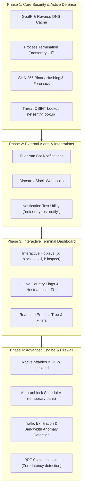

# 🛡️ NetSentry Development Roadmap

This document outlines the planned evolution of NetSentry across four core phases, turning it into a comprehensive Linux network security sentinel.

---

## 📅 Phases Overview

---

## 🎯 Phase 1: Core Security & Active Defense *(Completed)*

Focuses on elevating threat detection and mitigation capabilities with rich metadata and immediate remediation:

- [x] **GeoIP & Reverse DNS Resolver (`netsentry.core.resolver`)**:
  - Non-blocking reverse DNS lookups with in-memory & SQLite cache.
  - GeoIP resolution (country code, country name, city, organization/ASN).
  - Integration into socket scanners, threat alerts, and connection analysis.
- [x] **Binary Forensics & File Hashing**:
  - Automatic calculation of SHA-256 checksums for binaries associated with suspicious sockets.
  - Storage of hashes in the alerts database for forensic tracing and VirusTotal cross-checking.
- [x] **Active Process Defense**:
  - CLI command: `netsentry kill <PID>` with graceful SIGTERM and fallback to SIGKILL.
  - Configuration toggle: `"auto_kill_threats": false` for automated termination of high-confidence threats.
  - Tracking of terminated processes in the SQLite alert logs (`killed` column).
- [x] **Threat Intelligence Lookup (`netsentry lookup <IP>`)**:
  - Instant OSINT lookup command for any IP address.
  - Displays hostname, GeoIP location, local firewall status, local active sockets, and threat database categorization.

---

## 📢 Phase 2: External Notifications & Integrations *(Completed)*

Enables NetSentry to run effectively on headless servers and remote VPS instances:

- [x] **Telegram Bot Dispatcher**:
  - Instant security alerts sent directly to private chats or incident response channels via Telegram Bot API.
- [x] **Discord & Slack Webhooks**:
  - Formatted embeds with severity badges, process details, and remote IP indicators.
- [x] **CLI Testing Command**:
  - `netsentry test-notify` to verify desktop notifications, Telegram, and webhooks in one go.

---

## 🖥️ Phase 3: Interactive Terminal Dashboard *(Next Up)*

Transforms the monitoring view into a full interactive command center:

- **Live Interaction**:
  - Navigate sockets using arrow keys or Vim bindings (`j`/`k`).
  - Press `b` to instantly drop the IP in the firewall.
  - Press `k` to terminate the process.
  - Press `i` to open a modal with process details, executable hashes, and open files.
  - Press `/` to search and filter connections on the fly.
- **Visual Enhancements**:
  - Display country flags/codes and resolved hostnames directly in the connection table.

---

## 🧱 Phase 4: Advanced Engine & Next-Gen Networking

Deepens kernel integration and network control:

- **Firewall Enhancements**:
  - Native `nftables` support alongside `iptables`.
  - Automatic unblock expiration timer (e.g. temporary 1h / 24h quarantine).
- **Traffic Exfiltration Anomaly Engine**:
  - Per-process bandwidth metering (`KB/s`, `MB/s`).
  - Alert when unexpected processes stream large amounts of outbound data.
- **eBPF Kernel Probes**:
  - Zero-overhead kernel event tracing on socket transitions (`sock:inet_sock_set_state`).
