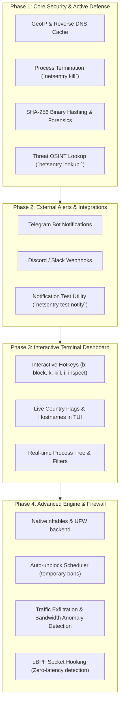

# 🛡️ NetSentry Development Roadmap

This document outlines the planned evolution of NetSentry across four core phases, turning it into a comprehensive Linux network security sentinel.

---

## 📅 Phases Overview

---

## 🎯 Phase 1: Core Security & Active Defense *(Completed)*

Focuses on elevating threat detection and mitigation capabilities with rich metadata and immediate remediation:

- [x] **GeoIP & Reverse DNS Resolver (`netsentry.core.resolver`)**:
  - Non-blocking reverse DNS lookups with in-memory & SQLite cache.
  - GeoIP resolution (country code, country name, city, organization/ASN).
  - Integration into socket scanners, threat alerts, and connection analysis.
- [x] **Binary Forensics & File Hashing**:
  - Automatic calculation of SHA-256 checksums for binaries associated with suspicious sockets.
  - Storage of hashes in the alerts database for forensic tracing and VirusTotal cross-checking.
- [x] **Active Process Defense**:
  - CLI command: `netsentry kill <PID>` with graceful SIGTERM and fallback to SIGKILL.
  - Configuration toggle: `"auto_kill_threats": false` for automated termination of high-confidence threats.
  - Tracking of terminated processes in the SQLite alert logs (`killed` column).
- [x] **Threat Intelligence Lookup (`netsentry lookup <IP>`)**:
  - Instant OSINT lookup command for any IP address.
  - Displays hostname, GeoIP location, local firewall status, local active sockets, and threat database categorization.

---

## 📢 Phase 2: External Notifications & Integrations *(Completed)*

Enables NetSentry to run effectively on headless servers and remote VPS instances:

- [x] **Telegram Bot Dispatcher**:
  - Instant security alerts sent directly to private chats or incident response channels via Telegram Bot API.
- [x] **Discord & Slack Webhooks**:
  - Formatted embeds with severity badges, process details, and remote IP indicators.
- [x] **CLI Testing Command**:
  - `netsentry test-notify` to verify desktop notifications, Telegram, and webhooks in one go.

---

## 🖥️ Phase 3: Interactive Terminal Dashboard *(Completed)*

Transforms the monitoring view into a full interactive command center:

- [x] **Live Interaction**:
  - Navigate sockets using arrow keys (`↑` / `↓`).
  - Press `b` to instantly drop the selected IP in the firewall.
  - Press `k` to terminate the selected process by PID.
  - Press `i` / `Enter` to open/close deep forensic inspector with process details, executable hashes, and GeoIP.
  - Press `?` / `h` for on-screen help modal.
  - Press `q` / `ESC` to exit cleanly.
- [x] **Visual Enhancements**:
  - Live cursor `▶`, selected row highlighting, country badges (`[PL]`, `[US]`, `[LAN]`), and responsive status bar.

---

## 🧱 Phase 4: Advanced Engine & Next-Gen Networking *(Completed)*

Deepens kernel integration, firewall control, and anomaly detection:

- [x] **Firewall Enhancements (`netsentry.core.firewall`)**:
  - Native multi-backend engine supporting `nftables`, `ufw`, and `iptables` with auto-detection.
  - Clean `inet netsentry` table and `@blocklist_v4` / `@blocklist_v6` sets for high performance and isolated management.
  - Full IPv6 support and safety guards against blocking loopback/multicast addresses.
- [x] **Auto-unblock Scheduler & Temporary Bans**:
  - Temporary quarantine timer via `netsentry block <IP> -d <minutes>` (or `-r <reason>`).
  - Automated expiration evaluator in daemon monitoring loop that safely releases expired blocks.
  - CLI command `netsentry blocked` displaying active blocks, reasons, and remaining quarantine time.
- [x] **Traffic Exfiltration Anomaly Engine (`netsentry.core.traffic`)**:
  - Real-time per-process outbound bandwidth tracking (`KB/s`) and cumulative transfer volume (`MB`).
  - Configurable rate and volume thresholds (`exfiltration_rate_threshold_kb_s`, `exfiltration_total_threshold_mb`).
  - Autonomous alerting, threat event generation, and optional auto-quarantine for exfiltrating processes.
  - CLI command `netsentry traffic` for live process network bandwidth metering.
- [x] **eBPF Kernel Probes & Diagnostic Subsystem (`netsentry.core.bpf`)**:
  - Kernel event tracing probe for socket transitions (`tcp_v4_connect`).
  - Graceful fallback to high-resolution socket polling when unprivileged or BCC library is not installed.
  - CLI command `netsentry bpf-status` for inspecting kernel tracing readiness and installation guidance.
